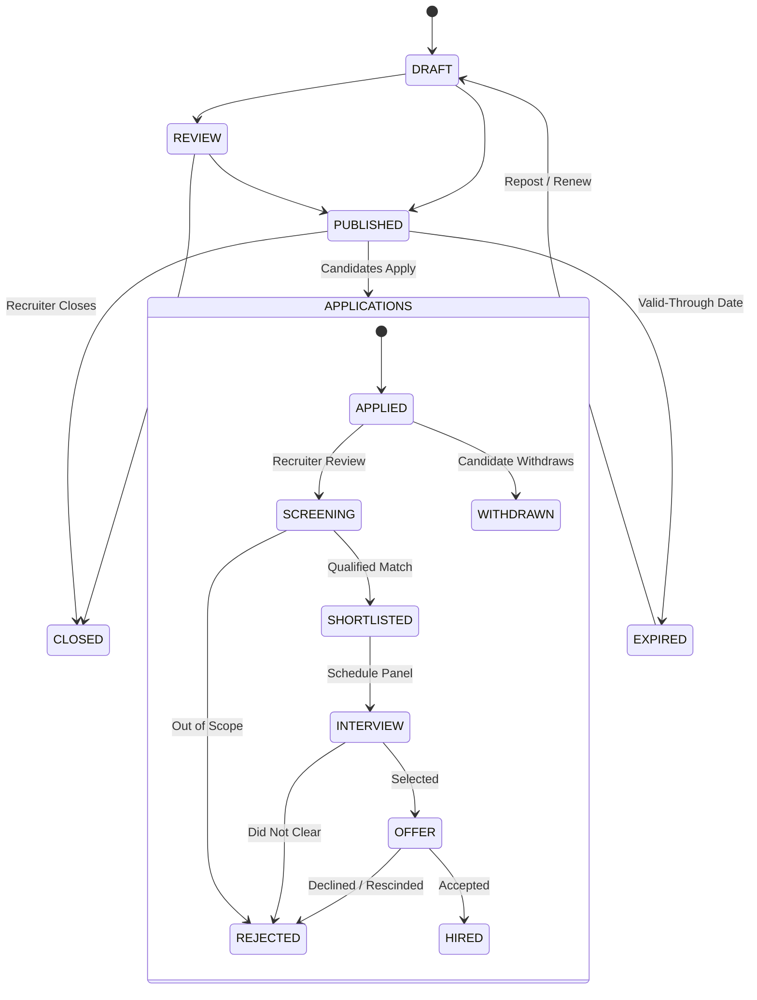

# TalentHub — System Architecture & Workflow Specification

## 1. High-Level Architecture Overview

TalentHub is built as a hybrid enterprise recruitment management system providing:
1. **Public Marketing & Job Board (Next.js 15 App Router)**: High-performance public portal with dual-mode data fetching (Static SSG and Dynamic API integration).
2. **Enterprise Recruitment Portal (`frontend/portal`)**: Dashboard for candidates, recruiters, and administrators with role-tailored pipelines.
3. **Core Backend (Django REST Framework 5.1)**: Central business logic, authorization, job publishing, application lifecycle, Celery background tasks, and PostgreSQL persistence.

```mermaid
graph TD
    Client[Next.js Public / Portal Frontend] --> |HTTPS / JSON REST API| Nginx[Nginx Reverse Proxy]
    Nginx --> |/api/v1/ & /media/| Django[Django REST Framework]
    Nginx --> |/* (Static Pages)| NextBuild[Next.js Static / SSR]
    Django --> |Read/Write| Postgres[(PostgreSQL Database)]
    Django --> |Task Dispatch| Redis[(Redis Broker & Cache)]
    Redis --> |Async Processing| Celery[Celery Background Workers]
    Celery --> |Email Dispatch| SMTP[SMTP Mail Server]
    Celery --> |Async Parsing| CVParser[Competency & Resume Matcher]
```

---

## 2. Recruitment Business Lifecycle

TalentHub strictly enforces the full recruitment lifecycle with state transitions, audit logging, and role-based permissions:



### Allowed Status Transitions Matrix

| Model | From Status | Permitted Target Statuses | Authorized Roles |
|---|---|---|---|
| **Job** | `DRAFT` | `REVIEW`, `PUBLISHED`, `CLOSED` | Recruiter, Admin |
| **Job** | `REVIEW` | `DRAFT`, `PUBLISHED`, `CLOSED` | Admin, Staff |
| **Job** | `PUBLISHED` | `CLOSED`, `EXPIRED` | Recruiter, Admin, System Cron |
| **Job** | `EXPIRED` | `DRAFT`, `REVIEW`, `PUBLISHED`, `CLOSED` | Recruiter, Admin |
| **Job** | `CLOSED` | `DRAFT` | Recruiter, Admin |
| **Application** | `APPLIED` | `SCREENING`, `SHORTLISTED`, `REJECTED`, `WITHDRAWN` | Candidate (Withdraw), Recruiter, Admin |
| **Application** | `SCREENING` | `SHORTLISTED`, `REJECTED`, `WITHDRAWN` | Candidate (Withdraw), Recruiter, Admin |
| **Application** | `SHORTLISTED` | `INTERVIEW`, `REJECTED`, `WITHDRAWN` | Candidate (Withdraw), Recruiter, Admin |
| **Application** | `INTERVIEW` | `OFFER`, `REJECTED` | Recruiter, Admin |
| **Application** | `OFFER` | `HIRED`, `REJECTED` | Recruiter, Admin |
| **Application** | `HIRED` | *(Terminal)* | N/A |
| **Application** | `REJECTED` | `SCREENING`, `SHORTLISTED` | Recruiter, Admin (Appeal/Reconsideration) |
| **Application** | `WITHDRAWN` | *(Terminal)* | N/A |

---

## 3. Dual-Mode Architecture (Static vs Dynamic)

TalentHub features a dedicated dual-mode architecture configured via `NEXT_PUBLIC_DATA_MODE`:

1. **Static Mode (`static`)**:
   - Compiles down to static HTML/JSON using Next.js SSG.
   - Jobs, blog articles, FAQs, and testimonials are loaded from `data/` local repositories.
   - Contact form routes directly to `/api/contact.php` for lightweight PHP SMTP delivery on shared hosting (e.g. Hostinger).
   - Candidate job application submissions clearly notify users when backend dynamic services are required, avoiding deceptive mock confirmations.

2. **Dynamic Mode (`dynamic`)**:
   - Integrates with Django REST API (`http://localhost:8000/api/v1` or production API gateway).
   - Real-time job search, candidate resume parsing, application status tracking, interview management, and dynamic CMS page editing.
   - PostgreSQL persistence with transactional database rollbacks and JWT session security.

---

## 4. Asynchronous Task Architecture & Reliability

- **Celery & Redis Broker**: Long-running background operations (such as CV parsing and transactional email dispatches) are processed via Celery with bounded retry limits (`max_retries=3`, `default_retry_delay=10`).
- **Resilient Fallback**: In environments where Celery/Redis is not running (e.g. lightweight development or test runner), `trigger_resume_parsing` and `safe_send_notification` automatically fallback to synchronous execution to ensure operations never fail.
