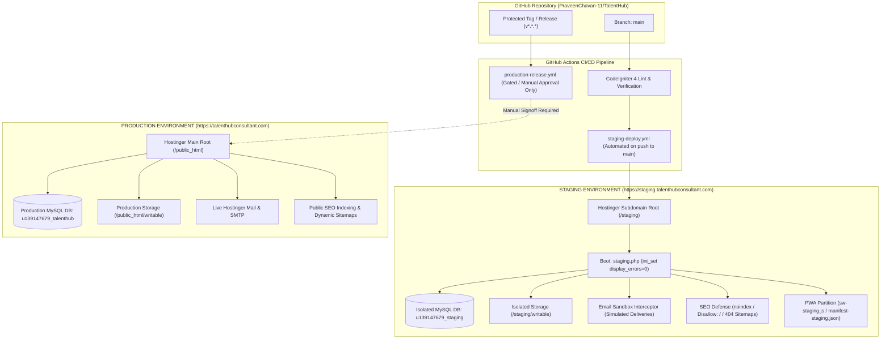

# TalentHub Consultant — Staging Architecture Specification

## 1. Executive Summary & Objective

This document defines the complete architectural specification for the fully isolated **Staging Environment** of TalentHub Consultant (`talenthubconsultant.com`).

The primary goal is establishing a replica testing platform (`https://staging.talenthubconsultant.com/`) that continuously tracks the GitHub `main` branch while guaranteeing that **zero** staging activity can ever leak into, pollute, or disrupt the live production website, its database, real customer inquiries, candidate CV uploads, or business operations.

---

## 2. Environment Topology & Physical Separation

| Architectural Dimension | Production Environment | Staging Environment | Isolation Mechanism |
|---|---|---|---|
| **Public Domain** | `https://talenthubconsultant.com/` | `https://staging.talenthubconsultant.com/` | Distinct Hostinger DNS & SSL vHost |
| **Server Document Root** | `/home/u139147679/domains/talenthubconsultant.com/public_html` | `/home/u139147679/domains/talenthubconsultant.com/public_html/staging` | Separate physical directory paths |
| **PHP Runtime Environment** | `CI_ENVIRONMENT = production` | `CI_ENVIRONMENT = staging` | Dedicated `app/Config/Boot/staging.php` |
| **Active MySQL Database** | `u139147679_talenthub` | `u139147679_staging` | Independent MySQL schemas & users |
| **Database Credentials** | User: `u139147679_talenthub` | User: `u139147679_staging` | Independent credentials & DB grants |
| **Session Cookie** | `ci_session` (path: `/`) | `ci_session_staging` (prefix: `th_staging_`) | Domain cookie isolation |
| **CSRF Cookie** | `csrf_cookie_name` | `csrf_cookie_staging` | Independent anti-tamper tokens |
| **File Storage Vault** | `.../public_html/writable/vault/resumes` | `.../staging/writable/vault/resumes` | Physical disk directory separation |
| **Public Uploads** | `.../public_html/public/uploads` | `.../staging/public/uploads` | Partitioned web-accessible assets |
| **PWA Manifest** | `manifest.json` (Theme: `#1D6A34`) | `manifest-staging.json` (Theme: `#D97706`) | Independent PWA identity |
| **Service Worker** | `sw.js` (Cache: `talenthub-cache-v3`) | `sw-staging.js` (Cache: `talenthub-staging-cache-v1`) | Cache & scope partitioning |
| **Email Delivery** | Live Hostinger SMTP & Mail API | Intercepted Staging Email Sandbox | Zero external delivery |
| **Search Engine Indexing**| `index, follow`, Sitemap active | `noindex, nofollow`, `robots.txt: Disallow: /` | 6-layer SEO defense shield |
| **Analytics (GA4/GTM)** | Enabled (`G-K6J0RWMLBS`) | Suppressed completely (`gaEnabled = false`) | Zero telemetry cross-contamination |

---

## 3. High-Level Architecture Diagram

---

## 4. Key Isolation Principles

1. **Defense-in-Depth Database Boundary**:
   - The staging MySQL user `u139147679_staging` has grants strictly bound to `u139147679_staging`.
   - Cross-database queries targeting `u139147679_talenthub` fail at the MySQL server layer with `SELECT/UPDATE command denied to user`.
   - `EnvironmentSafetyService::assertNotProduction()` inspects both environment name and active database name before allowing any destructive operations.

2. **Zero Live Email Policy**:
   - All transactional emails dispatched via `OutboxService` or `HostingerMailService` check `EnvironmentSafetyService::isEmailSandboxed()`.
   - In Staging, all outbound calls to SMTP servers and Hostinger SendApi are intercepted.
   - Subjects are automatically prefixed with `[STAGING TEST EMAIL]`.
   - Messages are logged into local outbox and message tables so administrators can review rendered HTML without sending emails to real candidates or clients.

3. **Multi-Layer Search Engine Shield**:
   - **Layer 1 (HTTP Headers)**: `X-Robots-Tag: noindex, nofollow, noarchive, nosnippet` emitted on all responses by `SecurityHeadersFilter`.
   - **Layer 2 (HTML Meta)**: `<meta name="robots" content="noindex, nofollow, noarchive, nosnippet">` in `<head>`.
   - **Layer 3 (Dynamic robots.txt)**: `Web\LegalController::robots()` returns `User-agent: *\nDisallow: /`.
   - **Layer 4 (Static robots.txt)**: `robots.txt` in staging document root returns `User-agent: *\nDisallow: /`.
   - **Layer 5 (Sitemap Suppression)**: `Web\SitemapController` routes return HTTP `404 Not Found` in staging.
   - **Layer 6 (Link Header Cleanup)**: Staging responses strip sitemap references from RFC 8288 discovery headers.

4. **Browser & Cache Partitioning**:
   - Staging PWA utilizes `sw-staging.js` with dedicated cache key `talenthub-staging-cache-v1`.
   - Staging cookies are prefixed with `th_staging_`, and session cookie is renamed to `ci_session_staging`.
   - Visiting staging and production in the same browser will never collide or overwrite session states.

